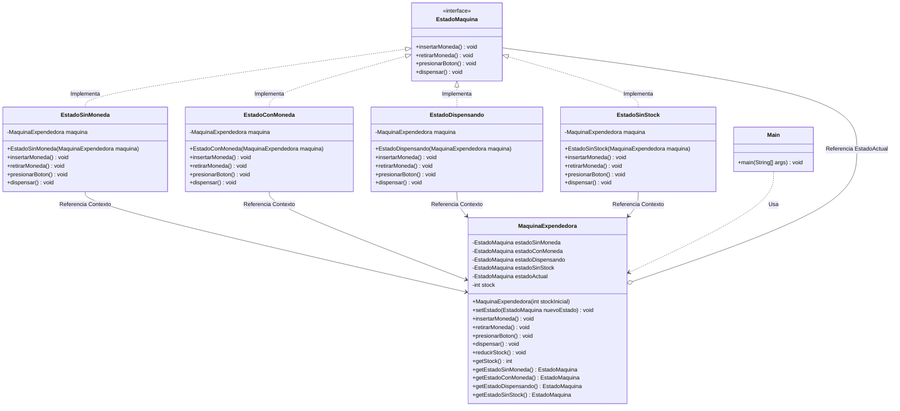

# Patrón State: Máquina Expendedora (Java)

Proyecto didáctico que muestra el **patrón de diseño State** (patrón de comportamiento del catálogo GoF).

## ¿Qué problema resuelve?

Un objeto cambia su comportamiento según su estado interno. La solución ingenua llena cada método de `if/else` o `switch`:
# Diagrama UML
```java
public void insertarMoneda() {
    if (estado == SIN_MONEDA) { ... }
    else if (estado == CON_MONEDA) { ... }
    else if (estado == DISPENSANDO) { ... }
    else if (estado == SIN_STOCK) { ... }
}
```

Cada vez que se agrega un estado hay que modificar **todos** los métodos (viola el principio Abierto/Cerrado).

## La idea del patrón

Cada estado se convierte en **una clase** que implementa una interfaz común. El objeto principal (el *contexto*) guarda una referencia al estado actual y le **delega** las acciones. Para cambiar de comportamiento, solo cambia el estado.

## Participantes

| Rol GoF | Clase en este proyecto | Responsabilidad |
|---|---|---|
| Context | `MaquinaExpendedora` | Guarda el estado actual y delega las acciones |
| State | `EstadoMaquina` (interfaz) | Declara las acciones: `insertarMoneda`, `devolverMoneda`, `presionarBoton`, `dispensar` |
| ConcreteState | `EstadoSinMoneda`, `EstadoConMoneda`, `EstadoDispensando`, `EstadoSinStock` | Implementan el comportamiento de cada estado y deciden la transición |

## Diagrama de estados

```
                 insertarMoneda
   ┌──────────────────────────────────────┐
   │                                      ▼
┌──────────────┐  devolverMoneda   ┌──────────────┐
│ SinMoneda    │◄──────────────────│ ConMoneda    │
└──────────────┘                   └──────┬───────┘
   ▲        ▲                              │ presionarBoton
   │        │ quedan productos             ▼
   │        └─────────────────────┌──────────────┐
   │                              │ Dispensando  │
   │                              └──────┬───────┘
   │                                     │ productos == 0
   │                                     ▼
   │                              ┌──────────────┐
   └──────── (inicio con stock)   │ SinStock     │
                                  └──────────────┘
```

## Estructura

```
patron-state/
├── README.md
└── src/maquina/
    ├── EstadoMaquina.java        (State)
    ├── MaquinaExpendedora.java   (Context)
    ├── EstadoSinMoneda.java      (ConcreteState)
    ├── EstadoConMoneda.java      (ConcreteState)
    ├── EstadoDispensando.java    (ConcreteState)
    ├── EstadoSinStock.java       (ConcreteState)
    └── Main.java                 (demo)
```

## Cómo ejecutarlo

```bash
cd patron-state
javac -encoding UTF-8 -d out src/maquina/*.java
java -Dfile.encoding=UTF-8 -cp out maquina.Main
```

## Puntos clave para explicar

1. **Sin condicionales de estado**: `MaquinaExpendedora` no pregunta "¿en qué estado estoy?"; solo delega.
2. **Las transiciones viven en los estados**: cada estado concreto decide cuál es el siguiente (`maquina.setEstado(...)`).
3. **Fácil de extender**: para agregar un estado, por ejemplo `EstadoMantenimiento`, se crea una clase nueva sin tocar las demás acciones.
4. **Costo**: más clases (una por estado). Vale la pena cuando hay varios estados y cada uno cambia el comportamiento de varias acciones.
5. **State vs Strategy**: tienen la misma estructura, pero en State los estados se conocen entre sí y se cambian solos; en Strategy el cliente elige la estrategia desde fuera.

## Ejercicios sugeridos

- Agregar un `EstadoMantenimiento` al que se entre por un método `activarMantenimiento()`.
- Hacer que la máquina requiera dos monedas.
- Agregar un estado "Ganador" con un 10 % de probabilidad de entregar un producto extra.

El siguiente diagrama en sintaxis **Mermaid** representa la estructura del patrón de diseño **State** basado en las clases del paquete `maquina` (`EstadoMaquina`, `MaquinaExpendedora`, `EstadoSinMoneda`, `EstadoConMoneda`, `EstadoDispensando`, `EstadoSinStock` y `Main`).


